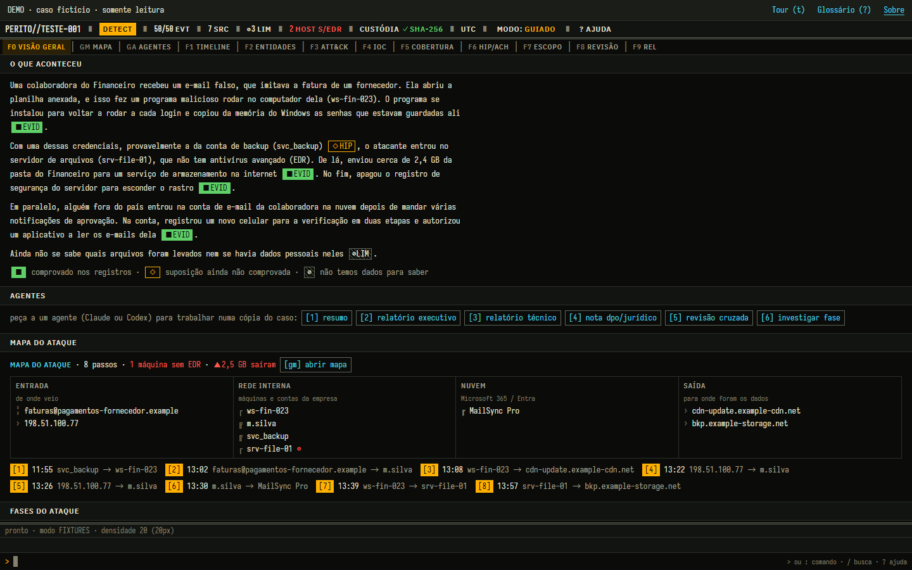
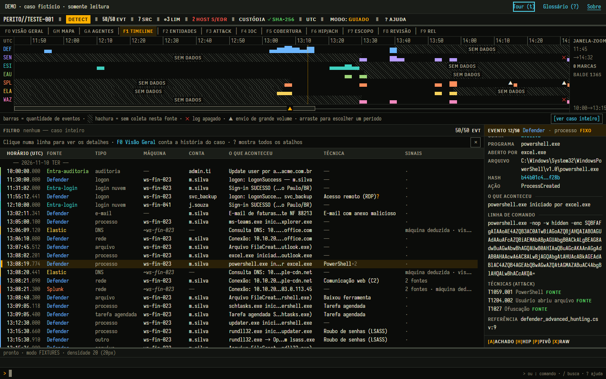

# Perito

[](https://github.com/ptkthg/perito/actions/workflows/ci.yml)


**Incident response (DFIR) toolkit.** Perito normalizes evidence from 7 security data sources (Microsoft Defender XDR,
Sentinel, Entra ID sign-in and audit, Splunk, Elastic and Wazuh) into a single UTC timeline with SHA-256 chain of custody
and MITRE ATT&CK mapping, and guides the investigation all the way to the executive report. Python standard library only
for parsing; React 19 analyst console; built spec-first, with Claude Code and Codex reviewing each other.

**Demonstração:** <!-- demo:url --> link publicado em breve <!-- /demo:url --> · caso fictício, dados 100% sintéticos,
somente leitura, com tour guiado.



## Por que existe
Num incidente real, as pistas estão espalhadas em ferramentas diferentes, cada uma com seu formato e seu fuso horário,
e o que se conclui precisa resistir a uma auditoria ou ao jurídico. O Perito segue o ciclo **NIST SP 800-61r3**, com
correspondência ao SANS PICERL, e resolve isso em quatro frentes:

| | O que faz | Como |
|---|---|---|
| **Reúne** | Normaliza 7 fontes num schema único de evento | Parsers puros (`parse(path) -> Iterator[Event]`) e detecção automática da fonte |
| **Organiza** | Monta uma timeline única em UTC, preservando o horário original | Conversão de fuso, com `[LIMITAÇÃO]` quando o fuso da fonte é desconhecido |
| **Preserva** | Mantém a cadeia de custódia | SHA-256 de toda evidência na entrada, conferível a qualquer momento (`perito verificar`) |
| **Investiga** | Sugere técnicas do MITRE ATT&CK, que o analista confirma | Toda afirmação aponta para o `arquivo:linha` do log original (`raw_ref`) |

Por cima disso vem um método de investigação. Toda afirmação recebe uma tag:
- `[EVIDÊNCIA]`: fato com prova;
- `[HIPÓTESE]`: inferência, com a confiança e o que a confirmaria ou a refutaria;
- `[LIMITAÇÃO]`: o que os dados não mostram.



**Fontes suportadas:**
- Microsoft Defender XDR (Advanced Hunting);
- Microsoft Sentinel (SecurityEvent, SigninLogs, AuditLogs, SecurityAlert, CommonSecurityLog, Device*);
- Entra ID (sign-in e audit);
- Splunk (Sysmon, Windows Security, firewall/proxy);
- Elastic (ECS);
- Wazuh (alerts.json).

## O que tem aqui
- **CLI e biblioteca Python** (`src/perito/`, cerca de 3,5 mil linhas, só biblioteca padrão): parsers, timeline,
  custódia, mapeamento ATT&CK, pivôs por host, conta, IP e hash, e extração de IOCs.
- **Console web do analista** (`ui/`, React 19 + TypeScript, cerca de 12 mil linhas), com navegação por teclado (F0 a F9)
  e modos guiado e analista. As visões são:
  - visão geral com o mapa do ataque e timeline com sismógrafo por fonte;
  - entidades, matriz ATT&CK, IOCs e cobertura;
  - hipóteses e achados, escopo, revisão cruzada e relatórios.
- **Skills para agentes** (`.agents/skills/`): triagem, abertura de caso, ingestão, timeline, investigação por fase,
  escopo, relatórios (técnico, executivo, RCA e nota ao DPO/Jurídico conforme a LGPD) e revisão cruzada.
- **Consultas prontas** em KQL e SPL por fase de ataque (`queries/`) e **templates** de relatório (`templates/`).
- **Caso sintético** com 50 eventos em 7 fontes e o gabarito (`samples/caso-sintetico/`), para testes e treino.

## Como usar
Requisitos: [uv](https://docs.astral.sh/uv/) e, para o console, Node 22.

```
uv run perito novo-caso IR-2026-001 --titulo "Phishing no Financeiro"
uv run perito ingerir IR-2026-001 caminho/dos/exports/ --obs "consulta Q0.1, janela ..."
uv run perito resumo IR-2026-001          # cobertura por fonte, janela, hosts, contas, técnicas
uv run perito timeline IR-2026-001 --host ws-fin-023 --de 2026-11-10T13:00Z
uv run perito pivo IR-2026-001 --ip 203.0.113.45
uv run perito iocs IR-2026-001 --gravar
uv run perito verificar IR-2026-001       # confere o SHA-256 de todas as evidências
uv run perito ui                          # abre o console local
```

Com o **Claude Code** ou o **Codex** aberto na raiz do repositório, dá para conduzir tudo em linguagem natural:

| Você diz | Skill |
|---|---|
| "Recebi este alerta do Defender: ..." | `triagem-alerta` |
| "Abre um caso para o incidente do Financeiro" | `novo-caso` |
| "Ingere estes exports" | `ingerir` |
| "Monta a timeline / quem foi o paciente zero?" | `timeline` |
| "Investiga movimentação lateral e exfiltração" | `investigar` |
| "Qual o escopo?" | `escopo` |
| "Gera o relatório executivo e a nota para o Jurídico" | `relatorio` |
| "Pede uma segunda opinião ao Codex" | `revisao-cruzada` |

A metodologia completa fica em [`AGENTS.md`](AGENTS.md).

Para treinar:
1. `uv run perito novo-caso TREINO-01`;
2. `uv run perito ingerir TREINO-01 samples/caso-sintetico`;
3. compare as suas conclusões com o [`GABARITO.md`](samples/caso-sintetico/GABARITO.md).

## Testes e qualidade
```
uv run pytest                 # 178 testes: parsers, timeline, ATT&CK, CLI e API do console
npm --prefix ui test          # 79 testes da interface (vitest)
npm --prefix ui run typecheck
```
O CI roda tudo isso a cada push, com permissão só de leitura e actions fixadas por SHA.

## Como foi construído
O Perito foi desenvolvido **guiado por especificações**. Eu, o autor, defino o problema, a metodologia DFIR, as specs
e as decisões de produto. Dois agentes de IA trabalham em papéis separados:

1. Cada entrega começa com uma spec em [`docs/tasks/`](docs/tasks/):
   - parsers, ATT&CK e timeline, CLI;
   - API do console, grafo, escrita pela interface;
   - agentes e a demonstração pública.
2. Um agente implementa (em geral o **Codex**) e registra o resultado em `NN-resultado.md`: o que fez, a saída dos
   testes, os desvios e as limitações.
3. O outro (**Claude Code**) revisa o diff com ceticismo, roda os testes e só então faz o commit.

O mesmo princípio vale para as investigações. A skill `revisao-cruzada` faz um agente revisar o trabalho do outro em
modo somente leitura, e as divergências são conciliadas por escrito. No caso de teste:
- a revisão encontrou erros inseridos de propósito;
- o que ela deixou passar virou melhoria na própria ferramenta.

## Demonstração pública
A pasta `ui/` gera uma demonstração estática (`npm --prefix ui run build:demo`), sem backend, com:
- o caso fictício;
- uma página de apresentação;
- um tour guiado de 7 passos, que termina no relatório executivo;
- um glossário para quem não é da área.

Ela é publicada com cabeçalhos de segurança (CSP sem recursos externos) definidos em [`ui/vercel.json`](ui/vercel.json).
O console do analista não muda: tudo da demo fica atrás de `VITE_DEMO=1`.

## Limitações
- Os parsers cobrem os formatos de exportação documentados no código. Outras variações de export podem exigir ajuste.
- O mapeamento ATT&CK automático é uma **sugestão** por regras e sempre precisa de confirmação do analista.
- A ingestão é de arquivos exportados: não há coleta direta nas ferramentas.

## Dados e privacidade
Casos reais ficam em `casos/`, fora do git. Todos os dados deste repositório (amostras, fixtures da interface e o caso
de demonstração) são **sintéticos**, com IPs e domínios reservados para documentação.

## Licença
[MIT](LICENSE) © 2026 Patrick Santos
